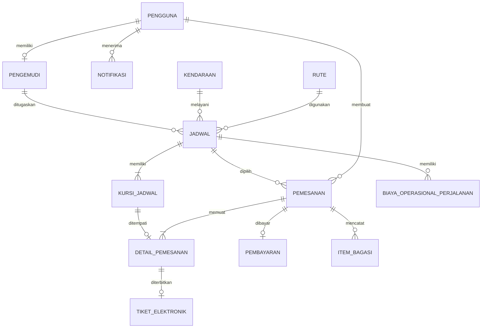

# Perancangan Basis Data RuslyTravel

## A. Penjelasan ERD

Basis data RuslyTravel dirancang untuk menghubungkan data pengguna, sumber daya operasional,
transaksi pemesanan, pembayaran, tiket, dan aktivitas perjalanan. Entitas `pengguna` menjadi
sumber identitas untuk tiga peran, yaitu penumpang, pengemudi, dan admin. Profil khusus pengemudi
dipisahkan ke tabel `pengemudi` agar atribut seperti nomor SIM dan status verifikasi tidak
bercampur dengan atribut akun umum.

Entitas operasional dimulai dari `rute`, `kendaraan`, dan `pengemudi`. Ketiganya dipertemukan pada
entitas `jadwal`. Setiap jadwal membentuk sekumpulan `kursi_jadwal`, sehingga status kursi tidak
menempel permanen pada kendaraan. Pendekatan ini memungkinkan kursi yang sama memiliki status
berbeda pada jadwal yang berbeda.

Pemesanan disimpan dalam dua tingkat. Tabel `pemesanan` memuat data transaksi utama dan snapshot
harga, sedangkan `detail_pemesanan` memuat satu baris untuk setiap penumpang/kursi. Pemisahan
tersebut memungkinkan satu pemesan membeli lebih dari satu tiket dengan nama penumpang yang
berbeda. Barang bawaan disimpan pada `item_bagasi`, pembayaran pada `pembayaran`, dan tiket
elektronik diterbitkan per `detail_pemesanan`.

Data operasional lain dipisahkan menjadi `biaya_operasional_perjalanan`, `notifikasi`,
`pengaturan_sistem`, dan `banner_beranda`. Pemisahan ini menjaga agar data transaksi historis
tidak berubah ketika pengaturan, harga rute, atau konten aplikasi diperbarui.

## B. Kardinalitas dan Constraint

| Relasi | Kardinalitas | Dasar Implementasi |
|---|---|---|
| pengguna — pengemudi | 1 : 0..1 | `pengemudi.pengguna_id` FK dan UNIQUE |
| pengguna — pemesanan | 1 : 0..N | satu akun dapat membuat banyak pemesanan |
| pengguna — notifikasi | 1 : 0..N | satu akun menerima banyak notifikasi |
| rute — jadwal | 1 : 0..N | satu rute dipakai banyak jadwal |
| kendaraan — jadwal | 1 : 0..N | satu kendaraan dipakai pada jadwal berbeda |
| pengemudi — jadwal | 1 : 0..N | satu pengemudi memiliki riwayat tugas |
| jadwal — kursi_jadwal | 1 : 1..N | kursi digenerasikan ketika jadwal dibuat |
| jadwal — pemesanan | 1 : 0..N | satu jadwal menerima banyak pemesanan |
| jadwal — biaya operasional | 1 : 0..N | satu perjalanan dapat mempunyai banyak biaya |
| pemesanan — detail_pemesanan | 1 : 1..N | satu baris per penumpang/kursi |
| pemesanan — pembayaran | 1 : 0..1 | `pembayaran.pemesanan_id` FK dan UNIQUE |
| pemesanan — item_bagasi | 1 : 0..N | barang bawaan dapat lebih dari satu |
| kursi_jadwal — detail_pemesanan | 1 : 0..1 | `detail_pemesanan.kursi_jadwal_id` UNIQUE |
| detail_pemesanan — tiket_elektronik | 1 : 0..1 | tiket muncul setelah pembayaran sah; FK UNIQUE |

Constraint penting:

```text
UNIQUE pengguna.email
UNIQUE pengguna.no_hp
UNIQUE pengemudi.pengguna_id
UNIQUE pengemudi.nomor_sim
UNIQUE kendaraan.nomor_plat
UNIQUE (kursi_jadwal.jadwal_id, kursi_jadwal.nomor_kursi)
UNIQUE pemesanan.kode_booking
UNIQUE pembayaran.pemesanan_id
UNIQUE pembayaran.order_id_gateway
UNIQUE detail_pemesanan.kursi_jadwal_id
UNIQUE tiket_elektronik.detail_pemesanan_id
UNIQUE tiket_elektronik.token_unik_qr
```

## C. Diagram Relasi Ringkas



## D. Struktur Tabel Utama

Tipe di bawah disederhanakan ke notasi laporan. Semua tabel bisnis mempunyai `created_at` dan
`updated_at`, kecuali jika disebut berbeda.

### 1. Tabel `pengguna`

| Kolom | Tipe | Keterangan |
|---|---|---|
| id | BIGINT, PK | Identitas akun |
| nama | VARCHAR(100) | Nama lengkap |
| email | VARCHAR(100), UQ | Email login |
| no_hp | VARCHAR(20), UQ | Nomor HP |
| foto_profil | VARCHAR(255), NULL | Path foto |
| peran | ENUM | `penumpang`, `pengemudi`, atau `admin` |
| token_push | VARCHAR(255), NULL | Cadangan token push |
| status_aktif | BOOLEAN | Status akun |
| email_verified_at | TIMESTAMP, NULL | Waktu verifikasi email |
| password | VARCHAR(255) | Hash kata sandi |
| otp_code | VARCHAR, NULL | Kode verifikasi |
| otp_expires_at | TIMESTAMP, NULL | Kedaluwarsa kode |

### 2. Tabel `pengemudi`

| Kolom | Tipe | Keterangan |
|---|---|---|
| id | BIGINT, PK | Identitas profil |
| pengguna_id | BIGINT, FK, UQ | Akun pengemudi |
| nomor_sim | VARCHAR(50), UQ | Nomor SIM/NIK yang digunakan |
| foto_sim | VARCHAR(255), NULL | Path foto SIM |
| status | ENUM | `aktif` atau `nonaktif` |
| status_verifikasi | ENUM | `menunggu`, `terverifikasi`, `ditolak` |
| catatan_verifikasi | TEXT, NULL | Catatan admin |
| verified_at | TIMESTAMP, NULL | Waktu verifikasi |
| verified_by | BIGINT, FK, NULL | Admin verifikator |

### 3. Tabel `rute`

| Kolom | Tipe | Keterangan |
|---|---|---|
| id | BIGINT, PK | Identitas rute |
| kota_asal | VARCHAR | Kota awal |
| kota_tujuan | VARCHAR | Kota akhir |
| deskripsi_jalur | VARCHAR/TEXT, NULL | Rincian jalur |
| jarak_km | DECIMAL, NULL | Jarak |
| estimasi_durasi_menit | INTEGER, NULL | Durasi dalam menit |
| harga_tiket | DECIMAL | Harga per kursi |
| status_aktif | BOOLEAN | Ketersediaan rute |

### 4. Tabel `kendaraan`

| Kolom | Tipe | Keterangan |
|---|---|---|
| id | BIGINT, PK | Identitas armada |
| nomor_plat | VARCHAR(20), UQ | Nomor polisi |
| merk_kendaraan | VARCHAR | Merek/model |
| warna | VARCHAR(30) | Warna |
| tahun_kendaraan | INTEGER, NULL | Tahun produksi |
| tipe_kendaraan | VARCHAR, NULL | Jenis kendaraan |
| kapasitas_kursi | INTEGER | Jumlah kursi |
| seat_layout | JSON, NULL | Denah kompatibilitas |
| fasilitas | TEXT, NULL | Fasilitas |
| total_kilometer | NUMERIC, NULL | Odometer |
| km_servis_berikutnya | NUMERIC, NULL | Target servis |
| tgl_terakhir_servis | DATE, NULL | Servis terakhir |
| tgl_pajak_tahunan | DATE, NULL | Jatuh tempo pajak |
| status_kendaraan | ENUM | `aktif`, `perawatan`, `nonaktif` |
| foto_kendaraan | VARCHAR, NULL | Foto kendaraan |

### 5. Tabel `jadwal`

| Kolom | Tipe | Keterangan |
|---|---|---|
| id | BIGINT, PK | Identitas jadwal |
| kendaraan_id | BIGINT, FK | Armada |
| rute_id | BIGINT, FK | Rute |
| pengemudi_id | BIGINT, FK | Pengemudi |
| waktu_berangkat | DATETIME | Waktu mulai |
| estimasi_tiba | DATETIME, NULL | Hasil waktu berangkat + durasi |
| status | ENUM | `draft`, `dibuka`, `ditutup`, `berangkat`, `selesai`, `dibatalkan` |

### 6. Tabel `kursi_jadwal`

| Kolom | Tipe | Keterangan |
|---|---|---|
| id | BIGINT, PK | Identitas kursi pada jadwal |
| jadwal_id | BIGINT, FK | Pemilik kursi |
| nomor_kursi | INTEGER | Nomor kursi |
| status_kursi | ENUM | `tersedia`, `terkunci`, `dipesan`, `nonaktif` |
| dikunci_oleh | BIGINT, FK, NULL | Pengguna yang mengunci |
| locked_at | DATETIME, NULL | Awal penguncian |
| lock_expires_at | DATETIME, NULL | Batas penguncian |

### 7. Tabel `pemesanan`

| Kolom | Tipe | Keterangan |
|---|---|---|
| id | BIGINT, PK | Identitas pemesanan |
| pengguna_id | BIGINT, FK | Pemesan |
| jadwal_id | BIGINT, FK | Jadwal |
| kode_booking | VARCHAR, UQ | Kode bisnis pemesanan |
| jumlah_kursi | INTEGER | Banyak tiket |
| batas_kunci_kursi | DATETIME, NULL | Snapshot batas form |
| batas_pembayaran | DATETIME, NULL | Snapshot batas pembayaran |
| lintang_jemput | DECIMAL, NULL | Latitude jemput |
| bujur_jemput | DECIMAL, NULL | Longitude jemput |
| alamat_jemput | TEXT, NULL | Alamat jemput |
| catatan_jemput | TEXT, NULL | Patokan/catatan |
| lintang_turun | DECIMAL, NULL | Latitude turun |
| bujur_turun | DECIMAL, NULL | Longitude turun |
| alamat_turun | TEXT, NULL | Alamat turun |
| catatan_turun | TEXT, NULL | Patokan/catatan |
| subtotal_tiket | DECIMAL | Snapshot harga tiket |
| total_harga | DECIMAL | Total pemesanan RuslyTravel |
| status_pemesanan | ENUM | `draft`, `menunggu_pembayaran`, `terbayar`, `dibatalkan`, `selesai` |

### 8. Tabel `detail_pemesanan`

| Kolom | Tipe | Keterangan |
|---|---|---|
| id | BIGINT, PK | Identitas penumpang |
| pemesanan_id | BIGINT, FK | Induk pemesanan |
| kursi_jadwal_id | BIGINT, FK, UQ | Kursi |
| nomor_kursi | INTEGER | Snapshot nomor kursi |
| nama_penumpang | VARCHAR | Nama pemilik tiket |
| no_hp_penumpang | VARCHAR(20) | Kontak penumpang |
| status_kehadiran | ENUM | `menunggu`, `hadir`, `tidak_hadir` |
| dijemput_pada | DATETIME, NULL | Waktu pickup |
| diturunkan_pada | DATETIME, NULL | Waktu dropoff |

### 9. Tabel `item_bagasi`

| Kolom | Tipe | Keterangan |
|---|---|---|
| id | BIGINT, PK | Identitas barang |
| pemesanan_id | BIGINT, FK | Induk pemesanan |
| deskripsi_item | VARCHAR | Nama/keterangan barang |
| metode_hitung | VARCHAR, NULL | Metadata cara pencatatan |
| posisi_barang | VARCHAR(30) | `dipegang_sendiri` atau `masuk_bagasi` |
| kategori_ukuran | VARCHAR(30), NULL | Kategori ukuran |
| jenis_barang_besar | VARCHAR(50), NULL | Jenis khusus |
| berat_kg | DECIMAL, NULL | Berat |
| ukuran_cm | DECIMAL, NULL | Ukuran gabungan |
| panjang_cm | DECIMAL, NULL | Panjang |
| lebar_cm | DECIMAL, NULL | Lebar |
| jumlah_item | INTEGER | Banyak barang |
| foto_url | VARCHAR, NULL | Foto utama |
| foto_urls | JSON, NULL | Beberapa foto |
| biaya_item | DECIMAL | Saat ini disimpan 0 |

### 10. Tabel `pembayaran`

| Kolom | Tipe | Keterangan |
|---|---|---|
| id | BIGINT, PK | Identitas pembayaran |
| pemesanan_id | BIGINT, FK, UQ | Maksimal satu pembayaran per pemesanan |
| order_id_gateway | VARCHAR, UQ, NULL | ID transaksi Pakasir |
| gateway_reference | VARCHAR, NULL | QR string/nomor VA lama |
| metode_bayar | VARCHAR(50) | QRIS, kode VA, cash, atau transfer legacy |
| paid_channel | VARCHAR, NULL | Kanal dari provider |
| nominal_transaksi | UNSIGNED BIGINT, NULL | Pendapatan RuslyTravel |
| biaya_admin_provider | UNSIGNED BIGINT, NULL | Fee provider |
| total_dibayar_penumpang | UNSIGNED BIGINT, NULL | Tagihan penumpang |
| payment_number | TEXT, NULL | QR string atau nomor VA |
| jumlah_bayar | DECIMAL | Kolom kompatibilitas |
| status_bayar | ENUM | `menunggu`, `berhasil`, `gagal`, `kedaluwarsa` |
| gateway_response | TEXT/JSON, NULL | Snapshot response provider |
| raw_webhook_payload | JSON/TEXT, NULL | Payload webhook |
| expired_at | DATETIME, NULL | Kedaluwarsa provider |
| webhook_verified_at | DATETIME, NULL | Waktu verifikasi |
| dibayar_pada | DATETIME, NULL | Waktu lunas |

### 11. Tabel `tiket_elektronik`

| Kolom | Tipe | Keterangan |
|---|---|---|
| id | BIGINT, PK | Identitas tiket |
| detail_pemesanan_id | BIGINT, FK, UQ | Pemilik tiket |
| kode_qr | VARCHAR | Kode bisnis terbaca |
| token_unik_qr | VARCHAR(100), UQ | Token validasi yang dipindai |
| sudah_dipindai | BOOLEAN | Status pemakaian |
| dipindai_pada | DATETIME, NULL | Waktu scan |
| diterbitkan_pada | DATETIME, NULL | Waktu terbit |

### 12. Tabel `biaya_operasional_perjalanan`

| Kolom | Tipe | Keterangan |
|---|---|---|
| id | BIGINT, PK | Identitas biaya |
| jadwal_id | BIGINT, FK | Perjalanan |
| jenis_biaya | VARCHAR | Jenis pengeluaran |
| nominal | DECIMAL | Nilai rupiah |
| keterangan | TEXT, NULL | Penjelasan |
| bukti_url | VARCHAR, NULL | Bukti foto |
| tanggal_biaya | DATE/DATETIME | Waktu biaya |
| status_verifikasi | VARCHAR(30) | Status pemeriksaan |
| diverifikasi_oleh | BIGINT, FK, NULL | Admin pemeriksa |
| diverifikasi_pada | DATETIME, NULL | Waktu pemeriksaan |
| catatan_verifikasi | TEXT, NULL | Catatan |
| created_by | BIGINT, FK, NULL | Pencatat |

### 13. Tabel `notifikasi`

| Kolom | Tipe | Keterangan |
|---|---|---|
| id | BIGINT, PK | Identitas notifikasi |
| pengguna_id | BIGINT, FK | Penerima |
| judul | VARCHAR | Judul |
| pesan | TEXT | Isi ringkas |
| jenis | ENUM | `pembayaran`, `perjalanan`, `sistem` |
| referensi_id | UNSIGNED BIGINT, NULL | ID pemesanan atau jadwal sesuai konteks |
| sudah_dibaca | BOOLEAN | Status baca |

`referensi_id` belum mempunyai pasangan `referensi_tipe` di migration. Implementasi membedakan
tujuan berdasarkan konteks notifikasi. Hal ini harus dicatat sebagai batas desain karena dua tabel
dapat memiliki nilai ID yang sama.

### 14. Tabel `pengaturan_sistem`

| Kolom | Tipe | Keterangan |
|---|---|---|
| id | BIGINT, PK | Identitas pengaturan |
| kelompok | VARCHAR | Kelompok pengaturan |
| kunci | VARCHAR(100), UQ | Nama konfigurasi |
| nilai | TEXT, NULL | Nilai |
| tipe | ENUM | string/integer/boolean/float/text |
| deskripsi | TEXT, NULL | Keterangan |
| diperbarui_oleh | BIGINT, FK, NULL | Admin |

### 15. Tabel `banner_beranda`

| Kolom | Tipe | Keterangan |
|---|---|---|
| id | BIGINT, PK | Identitas banner |
| judul | VARCHAR | Judul |
| subjudul | TEXT/VARCHAR, NULL | Deskripsi |
| path_gambar | VARCHAR, NULL | Lokasi gambar |
| aktif | BOOLEAN | Status tayang |
| urutan | INTEGER | Posisi |
| dibuat_oleh | BIGINT, FK, NULL | Admin |

## E. Tabel Teknis

Tabel `personal_access_tokens`, `password_reset_tokens`, `sessions`, `cache`, `cache_locks`,
`jobs`, `job_batches`, dan `failed_jobs` merupakan tabel teknis framework. Tabel tersebut boleh
disebutkan pada laporan, tetapi tidak perlu diuraikan sedetail tabel bisnis.

`pengaturan_sistem_legacy_backup` adalah arsip pengaturan generasi lama dan bukan sumber
konfigurasi runtime.

## F. Perubahan Penting terhadap ERD Lama

1. `pembayaran` sekarang memiliki snapshot `nominal_transaksi`, `biaya_admin_provider`,
   `total_dibayar_penumpang`, dan `payment_number`.
2. `order_id_gateway` bersifat unik.
3. `pembayaran.pemesanan_id` bersifat unik sehingga relasi menjadi 1 : 0..1.
4. `pengemudi.pengguna_id` bersifat unik.
5. `pemesanan` tidak lagi menyimpan kolom biaya admin, biaya bagasi, atau diskon.
6. `item_bagasi` menyimpan posisi, kategori, jenis barang besar, dimensi, dan beberapa foto.
7. `detail_pemesanan` menyimpan waktu dijemput dan diturunkan.
8. nama tabel aktif menjadi `pengaturan_sistem` dan `banner_beranda`.
9. `kursi_jadwal` mempunyai status `nonaktif`.
10. `jadwal` mempunyai status `ditutup`.

## G. Sumber Implementasi

- [`backend/database/migrations/`](../backend/database/migrations/)
- [`backend/app/Models/Pemesanan.php`](../backend/app/Models/Pemesanan.php)
- [`backend/app/Models/Jadwal.php`](../backend/app/Models/Jadwal.php)
- [`backend/app/Models/Pembayaran.php`](../backend/app/Models/Pembayaran.php)
- [`backend/app/Models/TiketElektronik.php`](../backend/app/Models/TiketElektronik.php)

## Catatan Statistik dan Reverb — 27 Juli 2026

Implementasi WebSocket tidak menambah tabel bisnis. Laravel Reverb hanya mengirim event setelah
perubahan `kursi_jadwal` tersimpan. Oleh karena itu relasi dan kardinalitas ERD tetap sama.

Card “Rute Paling Banyak Dikunjungi” juga tidak menambah kolom `jumlah_kunjungan` pada tabel
`rute`. Nilainya dihitung melalui:

```sql
COUNT(pemesanan.id)
SUM(pemesanan.jumlah_kursi)
```

dengan join `pemesanan → jadwal → rute` dan kondisi `status_pemesanan = selesai`. Pendekatan ini
menghindari duplikasi data rekap yang dapat tidak sinkron dengan transaksi sumber.
