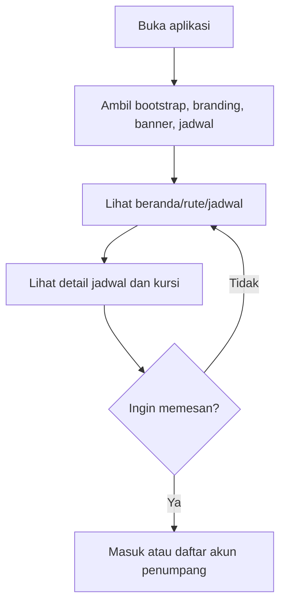
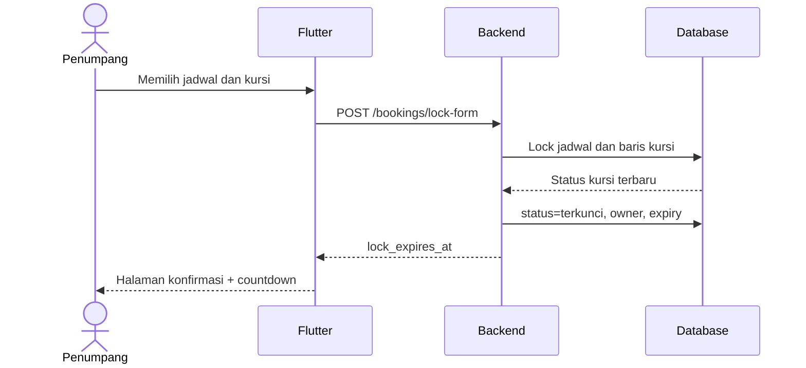
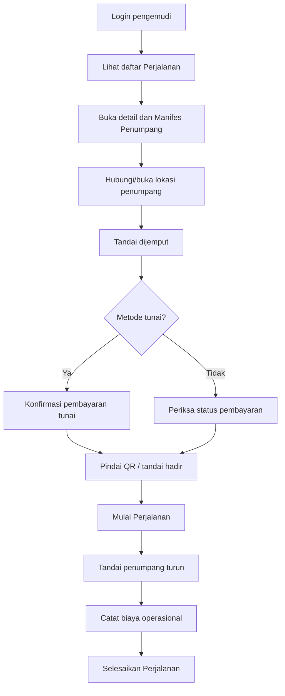

# Alur Kerja Pengguna RuslyTravel

## 1. Alur Tamu



Tamu hanya mengakses endpoint baca. Data jadwal tetap berasal dari backend. Mobile menyaring card
jadwal dengan `sisaKursi > 0` agar jadwal penuh tidak muncul pada beranda.

## 2. Alur Penumpang

### 2.1 Registrasi dan Login

1. Pengguna mengisi nama, email Gmail, nomor HP 11–12 digit, dan kata sandi minimal 6 karakter yang
   memuat huruf serta angka/simbol.
2. Backend memvalidasi keunikan email dan nomor HP.
3. Sistem membuat akun dengan peran `penumpang` dan menyimpan kata sandi ter-hash.
4. Kode verifikasi dikirim/dicatat untuk verifikasi email.
5. Setelah verifikasi, pengguna login dan menerima token Sanctum.

### 2.2 Pencarian sampai Penguncian Kursi



Jika pengguna lain membuka jadwal yang sama, API mengirim status `terkunci`; Flutter menampilkan
kursi tersebut berwarna abu-abu dan tidak mengizinkan pemilihan.

### 2.3 Konfirmasi Pemesanan

1. Penumpang mengisi data pemilik setiap kursi.
2. Penumpang memilih titik jemput dan turun serta menambahkan catatan.
3. Barang bawaan dapat dicatat beserta foto.
4. Flutter mengirim jadwal, nomor kursi, penumpang, lokasi, dan barang.
5. Backend memeriksa kembali kepemilikan kunci serta waktu kedaluwarsa.
6. Backend menghitung harga dari harga rute dan jumlah kursi.
7. `pemesanan` dibuat dengan status `menunggu_pembayaran`.
8. `detail_pemesanan` dibuat per kursi dan kunci kursi diperpanjang sampai batas pembayaran.
9. Belum ada transaksi Pakasir dan belum ada tiket.

Jika waktu form telah habis, backend menolak request. Scheduler atau request berikutnya melepaskan
kunci sehingga kursi kembali tersedia.

### 2.4 Pemilihan Pembayaran

#### Digital

1. Penumpang memilih QRIS atau bank Virtual Account.
2. Backend membuat satu record pembayaran lokal.
3. Backend memanggil Transaction Create Pakasir.
4. Response provider divalidasi dan disimpan sebagai snapshot.
5. Flutter menampilkan nominal, fee, total, payment number, batas waktu, serta tombol melanjutkan.
6. Pakasir mengirim webhook setelah pembayaran.
7. Backend memanggil Transaction Detail untuk verifikasi ulang.
8. Jika kedua status `completed`, pembayaran menjadi `berhasil`, pemesanan menjadi `terbayar`,
   kursi menjadi `dipesan`, dan tiket per penumpang diterbitkan.

#### Tunai

1. Penumpang memilih `cash`.
2. Backend tidak memanggil Pakasir.
3. Fee disimpan nol dan total sama dengan nominal.
4. `batas_pembayaran` serta `expired_at` dibuat null.
5. Kursi tetap ditahan sampai pembayaran dikonfirmasi pengemudi/admin.
6. Pembayaran tidak otomatis berhasil hanya karena metode dipilih.

### 2.5 Batas Waktu

```text
Sesi form habis
→ kunci form dilepas
→ tidak boleh membuat pemesanan dari data kedaluwarsa

Sesi pembayaran digital habis
→ status pembayaran kedaluwarsa
→ pemesanan dibatalkan
→ kursi dilepas

Tunai dipilih
→ tidak memakai countdown provider
→ menunggu konfirmasi saat pickup
```

### 2.6 Riwayat dan Tiket

- Pemesanan terbaru adalah jadwal yang belum lewat, termasuk pemesanan dibatalkan yang tanggal
  perjalanannya masih akan datang.
- Pemesanan lama adalah perjalanan berstatus selesai atau jadwal yang telah lewat.
- Tiket hanya terdapat pada detail penumpang setelah pembayaran berhasil.
- Setiap penumpang mempunyai QR dan nama pemilik tiket sendiri.
- File tiket dapat disimpan sebagai PNG ke galeri.

Sumber pembagian riwayat:

- [`frontend/lib/features/home/bagian_beranda/halaman_informasi.dart`](../frontend/lib/features/home/bagian_beranda/halaman_informasi.dart#L557)
- [`frontend/lib/features/home/travs_home_page.dart`](../frontend/lib/features/home/travs_home_page.dart#L1278)

## 3. Alur Pengemudi



Aturan penting:

1. pengemudi hanya dapat mengakses jadwal yang ditugaskan kepadanya;
2. manifes hanya memuat booking yang relevan dengan operasi;
3. token QR harus ditemukan, milik jadwal pengemudi aktif, dan belum pernah dipindai;
4. pemindaian mengubah tiket menjadi sudah dipindai dan penumpang menjadi hadir;
5. pickup tidak boleh dilakukan setelah penumpang turun atau ditandai tidak hadir;
6. dropoff membutuhkan urutan kondisi yang sah;
7. status jadwal hanya dapat berpindah `dibuka/ditutup → berangkat → selesai`;
8. ketika perjalanan selesai, booking `terbayar` berubah menjadi `selesai`;
9. booking tunai yang tidak pernah dikonfirmasi dibatalkan sebagai no-show;
10. ketika pengemudi menekan mulai perjalanan, admin mendapat notifikasi armada telah berangkat.

## 4. Alur Admin Web

### 4.1 Menyiapkan Operasional

1. Admin membuat/memperbarui rute dan harga.
2. Admin membuat kendaraan dan kapasitas kursi.
3. Admin membuat akun/profil pengemudi serta memverifikasi data.
4. Admin membuat jadwal dengan rute, kendaraan, pengemudi, waktu, status, dan kursi nonaktif.
5. Backend menghitung estimasi tiba.
6. Backend menolak kendaraan atau pengemudi yang mempunyai jadwal aktif pada tanggal yang sama.
7. Sistem membuat baris `kursi_jadwal` dan memberi notifikasi tugas kepada pengemudi.

### 4.2 Monitoring

- Dasbor menampilkan statistik dan rute terpopuler.
- Daftar jadwal menampilkan rute, armada, pengemudi, kursi, booking, dan status.
- Detail jadwal hanya memakai booking dengan pembayaran berhasil.
- Monitoring pemesanan menampilkan booking dari semua status.
- Detail pemesanan menunjukkan pembayaran, penumpang, lokasi, serta barang.
- Pembayaran tunai dapat dikonfirmasi hanya jika metode tunai dan status masih menunggu.
- Monitor Tiket memeriksa QR dan status pemindaian.

### 4.3 Keuangan dan Laporan

1. Pengemudi/admin mencatat biaya operasional.
2. Laporan pemesanan difilter status dan rentang tanggal.
3. Laporan transaksi difilter status, metode, dan rentang tanggal.
4. Pendapatan memakai `nominal_transaksi`, bukan total termasuk fee.
5. Export menghasilkan CSV atau XLS yang mengikuti filter.

### 4.4 Pengaturan

Admin dapat mengubah:

- identitas dan kontak aplikasi;
- maksimal kursi;
- durasi form dan pembayaran;
- auto-cancel;
- metode pembayaran aktif;
- instruksi tunai;
- notifikasi;
- informasi penting;
- banner beranda;
- akun admin.

Perubahan durasi memengaruhi transaksi baru. Pemesanan yang sudah dibuat tetap mempunyai snapshot
deadline sendiri.

## 5. Transisi Status

### 5.1 Status Jadwal

| Dari | Ke | Pemicu |
|---|---|---|
| draft | dibuka | admin menerbitkan jadwal |
| dibuka | ditutup | otomatis mendekati keberangkatan/admin |
| dibuka/ditutup | berangkat | pengemudi memulai |
| berangkat | selesai | pengemudi menyelesaikan |
| status tertentu | dibatalkan | kompatibilitas/data lama; bukan pilihan form aktif |

### 5.2 Status Pemesanan

| Status | Makna |
|---|---|
| draft | nilai enum kompatibilitas; alur aktif langsung membuat menunggu pembayaran |
| menunggu_pembayaran | booking dan kursi ada, belum lunas |
| terbayar | pembayaran sah dan tiket terbit |
| dibatalkan | kedaluwarsa/gagal/no-show atau tindakan sah lain |
| selesai | perjalanan booking telah selesai |

### 5.3 Status Pembayaran

| Status | Makna |
|---|---|
| menunggu | belum dikonfirmasi |
| berhasil | digital terverifikasi atau tunai dikonfirmasi |
| gagal | transaksi provider gagal |
| kedaluwarsa | batas digital habis |

## 6. Narasi Akademik Siap Pakai

> Alur utama sistem dimulai ketika penumpang memilih kursi. Backend mengunci baris kursi dalam
> transaksi database dan mengembalikan batas waktu pengisian. Setelah data penumpang serta lokasi
> dikirim, sistem membuat pemesanan berstatus menunggu pembayaran dan memperpanjang penguncian
> sampai batas pembayaran. Transaksi payment gateway baru dibuat setelah metode digital dipilih.
> Pembayaran yang dinyatakan selesai oleh webhook tetap diverifikasi melalui Transaction Detail
> API sebelum sistem menerbitkan tiket. Pada sisi operasional, pengemudi mengakses manifes jadwal
> yang ditugaskan, mencatat pickup, memverifikasi QR, mengonfirmasi tunai jika diperlukan,
> mencatat dropoff, dan menyelesaikan perjalanan. Admin mengelola data master serta jadwal,
> memantau transaksi, dan menghasilkan laporan dari snapshot data historis.

## Pembaruan Alur Kursi Real-Time — 27 Juli 2026

Ketika satu pengguna mengunci, melepaskan, atau memesan kursi, backend menyelesaikan transaksi
database lebih dahulu. Setelah perubahan berhasil disimpan, observer mengirim sinyal Reverb pada
channel jadwal. Perangkat lain yang sedang membuka jadwal tersebut menerima sinyal dan memanggil
API kursi kembali.

```text
Penumpang A mengubah status kursi
→ backend memvalidasi dan menyimpan
→ event jadwal dikirim
→ penumpang B menerima event
→ penumpang B mengambil seat map terbaru dari API
```

Apabila WebSocket terputus, polling API dan validasi backend tetap berjalan. Oleh sebab itu fitur
real-time meningkatkan kecepatan tampilan, tetapi tidak menggantikan pengamanan transaksi.
