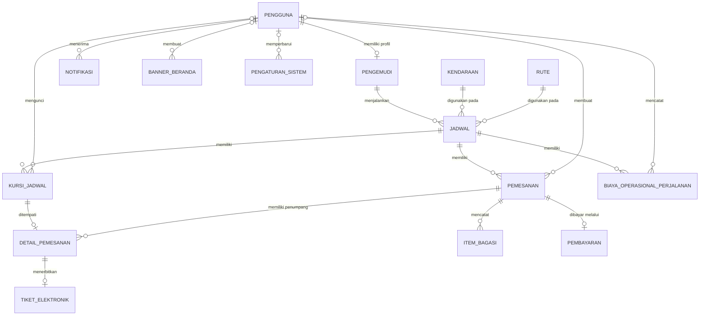

# Rekap Database dan Audit ERD RuslyTravel

## 1. Identitas dan Ruang Lingkup Audit

Dokumen ini merupakan rekap struktur database utama dan audit ERD untuk project:

- **Nama aplikasi:** RuslyTravel
- **Folder project:** `E:\POLNEP FILE\TUGAS AKHIR\AplikasiTravel`
- **Folder backend:** `E:\POLNEP FILE\TUGAS AKHIR\AplikasiTravel\backend`
- **Nama database pada konfigurasi:** `aplikasi_travel`
- **Framework backend:** Laravel 13
- **Tanggal audit awal:** 23 Juli 2026
- **Pembaruan berdasarkan database aktif:** 25 Juli 2026

Audit dilakukan berdasarkan:

1. Seluruh file migration di `backend/database/migrations`.
2. Seluruh model Eloquent di `backend/app/Models`.
3. Constraint primary key, foreign key, unique, nullable, dan aturan penghapusan.
4. Urutan migration sampai migration tanggal 25 Juli 2026.
5. Perbandingan dengan gambar ERD dan contoh data dictionary yang diberikan.
6. Introspeksi database MySQL aktif `aplikasi_travel`.

### Batasan audit

Pembaruan 25 Juli 2026 telah diverifikasi melalui database MySQL aktif
`aplikasi_travel`. Struktur tabel pada dokumen ini mengikuti hasil introspeksi
database aktif dan dicocokkan kembali dengan migration serta model Eloquent.

Migration backfill snapshot transaksi tunai lama masih berstatus `Pending`.
Migration tersebut tidak dijalankan dalam audit ini karena akan memperbarui
data pembayaran lama. Audit ini tidak mengubah data database.

---

## 2. Legenda

| Singkatan | Arti |
|---|---|
| PK | Primary Key |
| FK | Foreign Key |
| UQ | Unique Constraint |
| AI | Auto Increment |
| NULL | Nilai boleh kosong |
| NOT NULL | Nilai wajib tersedia |
| CASCADE | Data anak ikut terhapus ketika data induk dihapus |
| RESTRICT | Data induk tidak boleh dihapus jika masih mempunyai data anak |
| SET NULL | Nilai FK dibuat NULL ketika data induk dihapus |

Semua kolom `id` yang dibuat menggunakan `$table->id()` bertipe `BIGINT UNSIGNED AUTO_INCREMENT`.

Semua tabel yang menggunakan `$table->timestamps()` memiliki:

- `created_at TIMESTAMP NULL`
- `updated_at TIMESTAMP NULL`

---

## 3. Daftar Tabel Utama

Database bisnis RuslyTravel terdiri dari 15 tabel utama:

| No | Nama Tabel | Fungsi Utama |
|---:|---|---|
| 1 | `pengguna` | Menyimpan akun penumpang, pengemudi, dan admin |
| 2 | `pengemudi` | Menyimpan profil dan verifikasi pengemudi |
| 3 | `rute` | Menyimpan master rute dan tarif tiket |
| 4 | `kendaraan` | Menyimpan data armada kendaraan |
| 5 | `jadwal` | Menghubungkan rute, kendaraan, pengemudi, dan waktu perjalanan |
| 6 | `kursi_jadwal` | Menyimpan ketersediaan kursi untuk setiap jadwal |
| 7 | `pemesanan` | Menyimpan transaksi pemesanan perjalanan |
| 8 | `detail_pemesanan` | Menyimpan penumpang dan kursi dalam pemesanan |
| 9 | `item_bagasi` | Menyimpan catatan barang bawaan |
| 10 | `pembayaran` | Menyimpan transaksi pembayaran pemesanan |
| 11 | `tiket_elektronik` | Menyimpan tiket dan token QR penumpang |
| 12 | `notifikasi` | Menyimpan notifikasi pengguna dan admin |
| 13 | `biaya_operasional_perjalanan` | Menyimpan biaya operasional per jadwal |
| 14 | `banner_beranda` | Menyimpan banner beranda aplikasi |
| 15 | `pengaturan_sistem` | Menyimpan pengaturan aplikasi berbasis key-value |

### Tabel nonutama

Tabel berikut tidak perlu dimasukkan ke ERD bisnis utama:

- `pengaturan_sistem_legacy_backup`
- `password_reset_tokens`
- `sessions`
- `personal_access_tokens`
- `cache`
- `cache_locks`
- `jobs`
- `job_batches`
- `failed_jobs`
- `migrations`

`pengaturan_sistem_legacy_backup` merupakan backup tabel pengaturan lama dan bukan sumber pengaturan aktif aplikasi.

---

## 4. Gambaran Relasi Utama



Relasi verifikator dan pencatat yang menggunakan FK nullable dijelaskan secara khusus pada tabel kardinalitas.

`notifikasi.referensi_id` tidak ditampilkan sebagai relasi fisik pada diagram di atas karena bukan foreign key database. Kolom tersebut merupakan referensi logis yang dapat menunjuk ke `pemesanan.id` atau `jadwal.id`.

---

# 5. Data Dictionary Lengkap

## 5.1 Tabel `pengguna`

**Fungsi:** menyimpan seluruh akun penumpang, pengemudi, dan admin.

| No | Nama Kolom | Tipe Data | Constraint | Penjelasan |
|---:|---|---|---|---|
| 1 | `id` | BIGINT UNSIGNED | PK, AI | ID unik pengguna |
| 2 | `nama` | VARCHAR(255) | NOT NULL | Nama lengkap pengguna |
| 3 | `email` | VARCHAR(255) | NOT NULL, UQ | Email untuk pendaftaran dan login |
| 4 | `no_hp` | VARCHAR(20) | NOT NULL, UQ | Nomor HP/WhatsApp pengguna |
| 5 | `foto_profil` | VARCHAR(255) | NULL | Path atau URL foto profil |
| 6 | `peran` | ENUM | NOT NULL, default `penumpang` | Peran: `penumpang`, `pengemudi`, atau `admin` |
| 7 | `token_push` | VARCHAR(255) | NULL | Token perangkat untuk push notification |
| 8 | `status_aktif` | BOOLEAN | NOT NULL, default true | Menandai akun aktif atau nonaktif |
| 9 | `email_verified_at` | TIMESTAMP | NULL | Waktu email berhasil diverifikasi |
| 10 | `password` | VARCHAR(255) | NOT NULL | Password yang telah di-hash |
| 11 | `remember_token` | VARCHAR(100) | NULL | Token sesi remember-me |
| 12 | `otp_code` | VARCHAR(255) | NULL | Kode OTP pengguna |
| 13 | `otp_expires_at` | TIMESTAMP | NULL | Batas waktu berlaku OTP |
| 14 | `created_at` | TIMESTAMP | NULL | Waktu akun dibuat |
| 15 | `updated_at` | TIMESTAMP | NULL | Waktu akun diperbarui |

### Koreksi terhadap contoh data dictionary pengguna

| Pada contoh | Nama aktual |
|---|---|
| `id_pengguna` | `id` |
| `kata_sandi` | `password` |
| `token_notifikasi` | `token_push` |
| `dibuat_pada` | `created_at` |
| `diperbarui_pada` | `updated_at` |

Kolom `nama` dan `email` menggunakan `VARCHAR(255)`, bukan `VARCHAR(100)`.

---

## 5.2 Tabel `pengemudi`

**Fungsi:** menyimpan profil khusus, SIM, status, dan verifikasi akun pengemudi.

| No | Nama Kolom | Tipe Data | Constraint | Penjelasan |
|---:|---|---|---|---|
| 1 | `id` | BIGINT UNSIGNED | PK, AI | ID profil pengemudi |
| 2 | `pengguna_id` | BIGINT UNSIGNED | FK, UQ, NOT NULL | Akun pengguna pemilik profil |
| 3 | `nomor_sim` | VARCHAR(50) | UQ, NOT NULL | Nomor SIM pengemudi |
| 4 | `foto_sim` | VARCHAR(255) | NULL | Path foto SIM |
| 5 | `status` | ENUM | default `aktif` | `aktif` atau `nonaktif` |
| 6 | `status_verifikasi` | ENUM | default `menunggu` | `menunggu`, `terverifikasi`, atau `ditolak` |
| 7 | `catatan_verifikasi` | TEXT | NULL | Catatan hasil verifikasi |
| 8 | `verified_at` | TIMESTAMP | NULL | Waktu verifikasi |
| 9 | `verified_by` | BIGINT UNSIGNED | FK, NULL | Admin yang memverifikasi |
| 10 | `created_at` | TIMESTAMP | NULL | Waktu profil dibuat |
| 11 | `updated_at` | TIMESTAMP | NULL | Waktu profil diperbarui |

### Constraint

- `pengguna_id` → `pengguna.id`, `ON DELETE CASCADE`
- `verified_by` → `pengguna.id`, `ON DELETE SET NULL`
- `UNIQUE(pengguna_id)`
- `UNIQUE(nomor_sim)`

---

## 5.3 Tabel `rute`

**Fungsi:** menyimpan rute perjalanan, durasi, jarak, dan harga tiket aktif.

| No | Nama Kolom | Tipe Data | Constraint | Penjelasan |
|---:|---|---|---|---|
| 1 | `id` | BIGINT UNSIGNED | PK, AI | ID rute |
| 2 | `kota_asal` | VARCHAR(255) | NOT NULL | Kota keberangkatan |
| 3 | `kota_tujuan` | VARCHAR(255) | NOT NULL | Kota tujuan |
| 4 | `deskripsi_jalur` | VARCHAR(255) | NULL | Deskripsi jalur perjalanan |
| 5 | `jarak_km` | DECIMAL(8,2) | NULL | Jarak dalam kilometer |
| 6 | `estimasi_durasi_menit` | INT UNSIGNED | NULL | Estimasi durasi dalam menit |
| 7 | `harga_tiket` | DECIMAL(12,2) | NOT NULL | Tarif tiket yang berlaku untuk pemesanan baru |
| 8 | `status_aktif` | BOOLEAN | default true | Status rute |
| 9 | `created_at` | TIMESTAMP | NULL | Waktu dibuat |
| 10 | `updated_at` | TIMESTAMP | NULL | Waktu diperbarui |

---

## 5.4 Tabel `kendaraan`

**Fungsi:** menyimpan data armada yang digunakan pada jadwal perjalanan.

| No | Nama Kolom | Tipe Data | Constraint | Penjelasan |
|---:|---|---|---|---|
| 1 | `id` | BIGINT UNSIGNED | PK, AI | ID kendaraan |
| 2 | `nomor_plat` | VARCHAR(20) | UQ, NOT NULL | Nomor polisi kendaraan |
| 3 | `merk_kendaraan` | VARCHAR(255) | NOT NULL | Merk/nama armada |
| 4 | `warna` | VARCHAR(30) | NOT NULL | Warna kendaraan |
| 5 | `tahun_kendaraan` | INT UNSIGNED | NULL | Tahun produksi |
| 6 | `tipe_kendaraan` | VARCHAR(255) | NULL | Tipe kendaraan |
| 7 | `kapasitas_kursi` | INT UNSIGNED | NOT NULL | Kapasitas kursi |
| 8 | `seat_layout` | JSON | NULL | Konfigurasi susunan kursi |
| 9 | `fasilitas` | TEXT | NULL | Fasilitas kendaraan |
| 10 | `total_kilometer` | INT UNSIGNED | default 0 | Total kilometer penggunaan |
| 11 | `km_servis_berikutnya` | INT UNSIGNED | NULL | Kilometer servis berikutnya |
| 12 | `tgl_terakhir_servis` | DATE | NULL | Tanggal servis terakhir |
| 13 | `tgl_pajak_tahunan` | DATE | NULL | Tanggal pajak tahunan |
| 14 | `status_kendaraan` | ENUM | default `aktif` | `aktif`, `perawatan`, atau `nonaktif` |
| 15 | `foto_kendaraan` | VARCHAR(255) | NULL | Path foto kendaraan |
| 16 | `created_at` | TIMESTAMP | NULL | Waktu dibuat |
| 17 | `updated_at` | TIMESTAMP | NULL | Waktu diperbarui |

Walaupun form “Susunan Kursi Default” sudah dihapus dari UI, kolom `seat_layout` masih ada pada schema fisik dan digunakan model sebagai konfigurasi fallback.

---

## 5.5 Tabel `jadwal`

**Fungsi:** menghubungkan rute, armada, pengemudi, waktu, dan status perjalanan.

| No | Nama Kolom | Tipe Data | Constraint | Penjelasan |
|---:|---|---|---|---|
| 1 | `id` | BIGINT UNSIGNED | PK, AI | ID jadwal |
| 2 | `kendaraan_id` | BIGINT UNSIGNED | FK, NOT NULL | Armada yang digunakan |
| 3 | `rute_id` | BIGINT UNSIGNED | FK, NOT NULL | Rute perjalanan |
| 4 | `pengemudi_id` | BIGINT UNSIGNED | FK, NOT NULL | Pengemudi yang bertugas |
| 5 | `waktu_berangkat` | DATETIME | NOT NULL | Waktu keberangkatan |
| 6 | `estimasi_tiba` | DATETIME | NULL | Estimasi waktu tiba |
| 7 | `status` | ENUM | default `draft` | `draft`, `dibuka`, `ditutup`, `berangkat`, `selesai`, `dibatalkan` |
| 8 | `created_at` | TIMESTAMP | NULL | Waktu dibuat |
| 9 | `updated_at` | TIMESTAMP | NULL | Waktu diperbarui |

### Constraint

- `kendaraan_id` → `kendaraan.id`, `ON DELETE RESTRICT`
- `rute_id` → `rute.id`, `ON DELETE RESTRICT`
- `pengemudi_id` → `pengemudi.id`, `ON DELETE RESTRICT`

---

## 5.6 Tabel `kursi_jadwal`

**Fungsi:** menyimpan nomor dan status kursi untuk setiap jadwal.

| No | Nama Kolom | Tipe Data | Constraint | Penjelasan |
|---:|---|---|---|---|
| 1 | `id` | BIGINT UNSIGNED | PK, AI | ID kursi jadwal |
| 2 | `jadwal_id` | BIGINT UNSIGNED | FK, NOT NULL | Jadwal pemilik kursi |
| 3 | `nomor_kursi` | INT UNSIGNED | NOT NULL | Nomor kursi |
| 4 | `status_kursi` | ENUM | default `tersedia` | `tersedia`, `terkunci`, `dipesan`, `nonaktif` |
| 5 | `dikunci_oleh` | BIGINT UNSIGNED | FK, NULL | Pengguna yang mengunci kursi |
| 6 | `locked_at` | DATETIME | NULL | Waktu kursi dikunci |
| 7 | `lock_expires_at` | DATETIME | NULL | Batas waktu penguncian |
| 8 | `updated_at` | TIMESTAMP | NULL | Waktu perubahan terakhir |

### Constraint

- `jadwal_id` → `jadwal.id`, `ON DELETE CASCADE`
- `dikunci_oleh` → `pengguna.id`, `ON DELETE SET NULL`
- `UNIQUE(jadwal_id, nomor_kursi)`

Tabel ini tidak mempunyai `created_at`.

---

## 5.7 Tabel `pemesanan`

**Fungsi:** menyimpan transaksi pemesanan, lokasi perjalanan, tarif historis, dan batas waktu pembayaran.

| No | Nama Kolom | Tipe Data | Constraint | Penjelasan |
|---:|---|---|---|---|
| 1 | `id` | BIGINT UNSIGNED | PK, AI | ID pemesanan |
| 2 | `pengguna_id` | BIGINT UNSIGNED | FK, NOT NULL | Pengguna yang memesan |
| 3 | `jadwal_id` | BIGINT UNSIGNED | FK, NOT NULL | Jadwal yang dipesan |
| 4 | `kode_booking` | VARCHAR(255) | UQ, NOT NULL | Kode pemesanan |
| 5 | `jumlah_kursi` | INT UNSIGNED | NOT NULL | Jumlah kursi |
| 6 | `batas_kunci_kursi` | DATETIME | NULL | Batas sesi pengisian form |
| 7 | `batas_pembayaran` | DATETIME | NULL | Batas pembayaran |
| 8 | `lintang_jemput` | DECIMAL(10,7) | NULL | Latitude titik jemput |
| 9 | `bujur_jemput` | DECIMAL(10,7) | NULL | Longitude titik jemput |
| 10 | `alamat_jemput` | TEXT | NULL | Alamat titik jemput |
| 11 | `catatan_jemput` | VARCHAR(500) | NULL | Patokan/catatan jemput |
| 12 | `lintang_turun` | DECIMAL(10,7) | NULL | Latitude titik turun |
| 13 | `bujur_turun` | DECIMAL(10,7) | NULL | Longitude titik turun |
| 14 | `alamat_turun` | TEXT | NULL | Alamat titik turun |
| 15 | `catatan_turun` | VARCHAR(500) | NULL | Patokan/catatan turun |
| 16 | `subtotal_tiket` | DECIMAL(12,2) | default 0 | Nilai tiket historis |
| 17 | `total_harga` | DECIMAL(12,2) | default 0 | Total tagihan historis |
| 18 | `status_pemesanan` | ENUM | default `draft` | `draft`, `menunggu_pembayaran`, `terbayar`, `dibatalkan`, `selesai` |
| 19 | `created_at` | TIMESTAMP | NULL | Waktu dibuat |
| 20 | `updated_at` | TIMESTAMP | NULL | Waktu diperbarui |

### Constraint

- `pengguna_id` → `pengguna.id`, `ON DELETE CASCADE`
- `jadwal_id` → `jadwal.id`, `ON DELETE RESTRICT`
- `UNIQUE(kode_booking)`

### Kolom yang sudah dihapus

Kolom berikut tidak boleh dicantumkan dalam ERD terbaru:

- `biaya_admin`
- `biaya_bagasi`
- `diskon`

---

## 5.8 Tabel `detail_pemesanan`

**Fungsi:** menyimpan setiap penumpang beserta nomor kursi dan status perjalanan.

| No | Nama Kolom | Tipe Data | Constraint | Penjelasan |
|---:|---|---|---|---|
| 1 | `id` | BIGINT UNSIGNED | PK, AI | ID detail penumpang |
| 2 | `pemesanan_id` | BIGINT UNSIGNED | FK, NOT NULL | Pemesanan induk |
| 3 | `kursi_jadwal_id` | BIGINT UNSIGNED | FK, UQ, NOT NULL | Kursi yang ditempati |
| 4 | `nomor_kursi` | INT UNSIGNED | NOT NULL | Salinan nomor kursi |
| 5 | `nama_penumpang` | VARCHAR(255) | NOT NULL | Nama penumpang |
| 6 | `no_hp_penumpang` | VARCHAR(20) | NOT NULL | Nomor HP penumpang |
| 7 | `status_kehadiran` | ENUM | default `menunggu` | `menunggu`, `hadir`, `tidak_hadir` |
| 8 | `dijemput_pada` | DATETIME | NULL | Waktu penumpang dijemput |
| 9 | `diturunkan_pada` | DATETIME | NULL | Waktu penumpang turun |
| 10 | `created_at` | TIMESTAMP | NULL | Waktu dibuat |
| 11 | `updated_at` | TIMESTAMP | NULL | Waktu diperbarui |

### Constraint

- `pemesanan_id` → `pemesanan.id`, `ON DELETE CASCADE`
- `kursi_jadwal_id` → `kursi_jadwal.id`, `ON DELETE RESTRICT`
- `UNIQUE(kursi_jadwal_id)`

---

## 5.9 Tabel `item_bagasi`

**Fungsi:** mencatat barang bawaan pada pemesanan tanpa menambah tarif tiket.

| No | Nama Kolom | Tipe Data | Constraint | Penjelasan |
|---:|---|---|---|---|
| 1 | `id` | BIGINT UNSIGNED | PK, AI | ID barang bawaan |
| 2 | `pemesanan_id` | BIGINT UNSIGNED | FK, NOT NULL | Pemesanan pemilik barang |
| 3 | `deskripsi_item` | VARCHAR(255) | NOT NULL | Nama/deskripsi barang |
| 4 | `metode_hitung` | VARCHAR(20) | NULL | Metode pencatatan berat/ukuran |
| 5 | `posisi_barang` | VARCHAR(30) | default `masuk_bagasi` | Posisi barang |
| 6 | `kategori_ukuran` | VARCHAR(30) | NULL | Kategori kecil/besar |
| 7 | `jenis_barang_besar` | VARCHAR(50) | NULL | Sepeda, sepeda motor, beko, atau lainnya |
| 8 | `berat_kg` | DECIMAL(5,2) | NULL | Berat barang |
| 9 | `ukuran_cm` | INT UNSIGNED | NULL | Ukuran umum legacy |
| 10 | `panjang_cm` | INT UNSIGNED | NULL | Panjang barang |
| 11 | `lebar_cm` | INT UNSIGNED | NULL | Lebar barang |
| 12 | `jumlah_item` | INT UNSIGNED | default 1 | Jumlah barang |
| 13 | `foto_url` | VARCHAR(255) | NULL | Foto utama/legacy |
| 14 | `foto_urls` | JSON | NULL | Daftar foto barang |
| 15 | `biaya_item` | DECIMAL(12,2) | default 0 | Kolom legacy, saat ini bernilai nol |
| 16 | `created_at` | TIMESTAMP | NULL | Waktu dibuat |
| 17 | `updated_at` | TIMESTAMP | NULL | Waktu diperbarui |

### Constraint

- `pemesanan_id` → `pemesanan.id`, `ON DELETE CASCADE`

---

## 5.10 Tabel `pembayaran`

**Fungsi:** menyimpan pembayaran tunai maupun gateway untuk satu pemesanan.

| No | Nama Kolom | Tipe Data | Constraint | Penjelasan |
|---:|---|---|---|---|
| 1 | `id` | BIGINT UNSIGNED | PK, AI | ID pembayaran |
| 2 | `pemesanan_id` | BIGINT UNSIGNED | FK, UQ, NOT NULL | Pemesanan yang dibayar |
| 3 | `order_id_gateway` | VARCHAR(255) | UQ, NULL | ID transaksi gateway |
| 4 | `gateway_reference` | VARCHAR(255) | NULL | Referensi dari gateway |
| 5 | `metode_bayar` | VARCHAR(50) | NOT NULL | Metode pembayaran |
| 6 | `paid_channel` | VARCHAR(255) | NULL | Kanal pembayaran |
| 7 | `nominal_transaksi` | BIGINT UNSIGNED | NULL | Snapshot nominal transaksi RuslyTravel dari respons provider |
| 8 | `biaya_admin_provider` | BIGINT UNSIGNED | NULL | Snapshot biaya admin yang dikembalikan provider |
| 9 | `total_dibayar_penumpang` | BIGINT UNSIGNED | NULL | Snapshot `total_payment` yang dikembalikan provider |
| 10 | `payment_number` | TEXT | NULL | QR string atau nomor Virtual Account |
| 11 | `jumlah_bayar` | DECIMAL(12,2) | default 0 | Kolom nominal lama untuk kompatibilitas transaksi existing |
| 12 | `status_bayar` | ENUM | default `menunggu` | `menunggu`, `berhasil`, `gagal`, `kedaluwarsa` |
| 13 | `gateway_response` | TEXT | NULL | Snapshot ringkasan respons gateway |
| 14 | `raw_webhook_payload` | JSON | NULL | Payload webhook |
| 15 | `expired_at` | DATETIME | NULL | Kedaluwarsa pembayaran |
| 16 | `webhook_verified_at` | DATETIME | NULL | Waktu verifikasi webhook |
| 17 | `dibayar_pada` | DATETIME | NULL | Waktu pembayaran berhasil |
| 18 | `created_at` | TIMESTAMP | NULL | Waktu dibuat |
| 19 | `updated_at` | TIMESTAMP | NULL | Waktu diperbarui |

### Constraint

- `pemesanan_id` → `pemesanan.id`, `ON DELETE CASCADE`
- `UNIQUE(pemesanan_id)`
- `UNIQUE(order_id_gateway)`

Satu pemesanan hanya dapat mempunyai maksimal satu record pembayaran.

### Migration pembayaran terbaru

| Migration | Status | Dampak |
|---|---|---|
| `2026_07_24_220000_add_unique_order_id_gateway_to_pembayaran_table.php` | Ran | Menambahkan unique constraint pada `order_id_gateway` |
| `2026_07_24_221000_add_payment_amount_snapshots_to_pembayaran_table.php` | Ran | Menambahkan empat kolom snapshot pembayaran provider |
| `2026_07_24_221100_backfill_payment_amount_snapshots.php` | Ran | Mengisi snapshot pembayaran digital lama dari data provider yang tersimpan |
| `2026_07_25_000100_backfill_cash_payment_snapshots.php` | Pending | Hanya mengisi snapshot transaksi tunai lama; tidak mengubah struktur tabel |

Migration yang masih pending akan mengisi `nominal_transaksi`,
`biaya_admin_provider = 0`, dan `total_dibayar_penumpang` untuk transaksi tunai
lama. Migration itu juga memastikan `order_id_gateway`, `payment_number`, dan
`expired_at` kosong pada pembayaran tunai. Kode transaksi baru tidak bergantung
pada backfill tersebut.

---

## 5.11 Tabel `tiket_elektronik`

**Fungsi:** menyimpan tiket dan token QR untuk setiap penumpang.

| No | Nama Kolom | Tipe Data | Constraint | Penjelasan |
|---:|---|---|---|---|
| 1 | `id` | BIGINT UNSIGNED | PK, AI | ID tiket |
| 2 | `detail_pemesanan_id` | BIGINT UNSIGNED | FK, UQ, NOT NULL | Penumpang pemilik tiket |
| 3 | `kode_qr` | VARCHAR(255) | NOT NULL | Isi/kode QR |
| 4 | `token_unik_qr` | VARCHAR(100) | UQ, NOT NULL | Token unik verifikasi QR |
| 5 | `sudah_dipindai` | BOOLEAN | default false | Status scan |
| 6 | `dipindai_pada` | DATETIME | NULL | Waktu scan |
| 7 | `diterbitkan_pada` | DATETIME | NULL | Waktu tiket diterbitkan |
| 8 | `created_at` | TIMESTAMP | NULL | Waktu dibuat |
| 9 | `updated_at` | TIMESTAMP | NULL | Waktu diperbarui |

### Constraint

- `detail_pemesanan_id` → `detail_pemesanan.id`, `ON DELETE CASCADE`
- `UNIQUE(detail_pemesanan_id)`
- `UNIQUE(token_unik_qr)`

---

## 5.12 Tabel `notifikasi`

**Fungsi:** menyimpan notifikasi untuk penumpang, pengemudi, dan admin.

| No | Nama Kolom | Tipe Data | Constraint | Penjelasan |
|---:|---|---|---|---|
| 1 | `id` | BIGINT UNSIGNED | PK, AI | ID notifikasi |
| 2 | `pengguna_id` | BIGINT UNSIGNED | FK, NOT NULL | Penerima notifikasi |
| 3 | `judul` | VARCHAR(255) | NOT NULL | Judul notifikasi |
| 4 | `pesan` | TEXT | NOT NULL | Isi notifikasi |
| 5 | `jenis` | ENUM | default `sistem` | `pembayaran`, `perjalanan`, atau `sistem` |
| 6 | `referensi_id` | BIGINT UNSIGNED | NULL, bukan FK | Referensi logis pemesanan/jadwal |
| 7 | `sudah_dibaca` | BOOLEAN | default false | Status baca |
| 8 | `created_at` | TIMESTAMP | NULL | Waktu dibuat |
| 9 | `updated_at` | TIMESTAMP | NULL | Waktu diperbarui |

### Constraint

- `pengguna_id` → `pengguna.id`, `ON DELETE CASCADE`

### Catatan referensi

`referensi_id` bukan foreign key fisik. Dalam aplikasi, nilainya dapat menunjuk:

- `pemesanan.id`; atau
- `jadwal.id`.

Relasi tersebut harus digambar sebagai relasi logis/polimorfik dengan garis putus-putus jika dimasukkan ke ERD.

---

## 5.13 Tabel `biaya_operasional_perjalanan`

**Fungsi:** mencatat biaya operasional yang terkait dengan satu jadwal.

| No | Nama Kolom | Tipe Data | Constraint | Penjelasan |
|---:|---|---|---|---|
| 1 | `id` | BIGINT UNSIGNED | PK, AI | ID biaya |
| 2 | `jadwal_id` | BIGINT UNSIGNED | FK, NOT NULL | Jadwal terkait |
| 3 | `jenis_biaya` | VARCHAR(255) | NOT NULL | Jenis biaya |
| 4 | `nominal` | DECIMAL(12,2) | NOT NULL | Nominal biaya |
| 5 | `keterangan` | TEXT | NULL | Keterangan biaya |
| 6 | `bukti_url` | VARCHAR(255) | NULL | Path bukti/nota |
| 7 | `status_verifikasi` | VARCHAR(30) | default `disetujui` | Status verifikasi legacy |
| 8 | `diverifikasi_oleh` | BIGINT UNSIGNED | FK, NULL | Pengguna yang memverifikasi |
| 9 | `diverifikasi_pada` | TIMESTAMP | NULL | Waktu verifikasi |
| 10 | `catatan_verifikasi` | TEXT | NULL | Catatan verifikasi |
| 11 | `tanggal_biaya` | DATETIME | NOT NULL | Tanggal pengeluaran |
| 12 | `created_by` | BIGINT UNSIGNED | FK, NULL | Pengguna pencatat |
| 13 | `created_at` | TIMESTAMP | NULL | Waktu dibuat |
| 14 | `updated_at` | TIMESTAMP | NULL | Waktu diperbarui |

### Constraint

- `jadwal_id` → `jadwal.id`, `ON DELETE CASCADE`
- `created_by` → `pengguna.id`, `ON DELETE SET NULL`
- `diverifikasi_oleh` → `pengguna.id`, `ON DELETE SET NULL`

Kolom verifikasi masih ada pada schema untuk kompatibilitas data lama. Alur aplikasi saat ini langsung mencatat biaya sebagai final/disetujui.

---

## 5.14 Tabel `banner_beranda`

**Fungsi:** menyimpan banner yang ditampilkan pada beranda aplikasi.

| No | Nama Kolom | Tipe Data | Constraint | Penjelasan |
|---:|---|---|---|---|
| 1 | `id` | BIGINT UNSIGNED | PK, AI | ID banner |
| 2 | `judul` | VARCHAR(120) | NOT NULL | Judul banner |
| 3 | `subjudul` | VARCHAR(255) | NULL | Subjudul banner |
| 4 | `path_gambar` | VARCHAR(255) | NOT NULL | Path gambar |
| 5 | `aktif` | BOOLEAN | default true, index | Status banner |
| 6 | `urutan` | INT UNSIGNED | default 0 | Urutan tampilan |
| 7 | `dibuat_oleh` | BIGINT UNSIGNED | FK, NULL | Pengguna pembuat |
| 8 | `created_at` | TIMESTAMP | NULL | Waktu dibuat |
| 9 | `updated_at` | TIMESTAMP | NULL | Waktu diperbarui |

### Constraint

- `dibuat_oleh` → `pengguna.id`, `ON DELETE SET NULL`

### Perubahan nama

- Nama tabel lama: `home_banners`
- Nama tabel final: `banner_beranda`
- Nama kolom lama: `gambar_path`
- Nama kolom final: `path_gambar`

---

## 5.15 Tabel `pengaturan_sistem`

**Fungsi:** menyimpan pengaturan aktif aplikasi dalam format key-value.

| No | Nama Kolom | Tipe Data | Constraint | Penjelasan |
|---:|---|---|---|---|
| 1 | `id` | BIGINT UNSIGNED | PK, AI | ID pengaturan |
| 2 | `kelompok` | VARCHAR(50) | NOT NULL, index | Kelompok pengaturan |
| 3 | `kunci` | VARCHAR(100) | UQ, NOT NULL | Kunci pengaturan |
| 4 | `nilai` | TEXT | NULL | Nilai pengaturan |
| 5 | `tipe` | ENUM | default `string` | `string`, `integer`, `boolean`, `float`, `text` |
| 6 | `deskripsi` | VARCHAR(255) | NULL | Penjelasan pengaturan |
| 7 | `diperbarui_oleh` | BIGINT UNSIGNED | FK, NULL | Pengguna terakhir yang memperbarui |
| 8 | `created_at` | TIMESTAMP | NULL | Waktu dibuat |
| 9 | `updated_at` | TIMESTAMP | NULL | Waktu diperbarui |

### Constraint

- `diperbarui_oleh` → `pengguna.id`, `ON DELETE SET NULL`
- `UNIQUE(kunci)`

### Perubahan nama

| Nama lama | Nama final |
|---|---|
| `system_settings` | `pengaturan_sistem` |
| `group` | `kelompok` |
| `key` | `kunci` |
| `value` | `nilai` |
| `type` | `tipe` |
| `description` | `deskripsi` |
| `updated_by` | `diperbarui_oleh` |

---

# 6. Rekap Foreign Key dan Aturan Penghapusan

| Tabel Anak | Foreign Key | Tabel Induk | Aturan Delete |
|---|---|---|---|
| `pengemudi` | `pengguna_id` | `pengguna.id` | CASCADE |
| `pengemudi` | `verified_by` | `pengguna.id` | SET NULL |
| `jadwal` | `kendaraan_id` | `kendaraan.id` | RESTRICT |
| `jadwal` | `rute_id` | `rute.id` | RESTRICT |
| `jadwal` | `pengemudi_id` | `pengemudi.id` | RESTRICT |
| `kursi_jadwal` | `jadwal_id` | `jadwal.id` | CASCADE |
| `kursi_jadwal` | `dikunci_oleh` | `pengguna.id` | SET NULL |
| `pemesanan` | `pengguna_id` | `pengguna.id` | CASCADE |
| `pemesanan` | `jadwal_id` | `jadwal.id` | RESTRICT |
| `detail_pemesanan` | `pemesanan_id` | `pemesanan.id` | CASCADE |
| `detail_pemesanan` | `kursi_jadwal_id` | `kursi_jadwal.id` | RESTRICT |
| `item_bagasi` | `pemesanan_id` | `pemesanan.id` | CASCADE |
| `pembayaran` | `pemesanan_id` | `pemesanan.id` | CASCADE |
| `tiket_elektronik` | `detail_pemesanan_id` | `detail_pemesanan.id` | CASCADE |
| `notifikasi` | `pengguna_id` | `pengguna.id` | CASCADE |
| `biaya_operasional_perjalanan` | `jadwal_id` | `jadwal.id` | CASCADE |
| `biaya_operasional_perjalanan` | `created_by` | `pengguna.id` | SET NULL |
| `biaya_operasional_perjalanan` | `diverifikasi_oleh` | `pengguna.id` | SET NULL |
| `banner_beranda` | `dibuat_oleh` | `pengguna.id` | SET NULL |
| `pengaturan_sistem` | `diperbarui_oleh` | `pengguna.id` | SET NULL |

`notifikasi.referensi_id` tidak masuk tabel di atas karena bukan foreign key.

---

# 7. Rekap Kardinalitas

| Entitas Induk | Relasi | Entitas Anak | Kardinalitas Fisik |
|---|---|---|---|
| `pengguna` | mempunyai profil | `pengemudi` | 1 — 0..1 |
| `pengguna` | memverifikasi profil | `pengemudi` | 1 — 0..N |
| `pengguna` | membuat pemesanan | `pemesanan` | 1 — 0..N |
| `pengguna` | menerima notifikasi | `notifikasi` | 1 — 0..N |
| `pengguna` | mengunci kursi | `kursi_jadwal` | 1 — 0..N |
| `pengguna` | mencatat biaya | `biaya_operasional_perjalanan` | 1 — 0..N |
| `pengguna` | memverifikasi biaya | `biaya_operasional_perjalanan` | 1 — 0..N |
| `pengguna` | membuat banner | `banner_beranda` | 1 — 0..N |
| `pengguna` | memperbarui pengaturan | `pengaturan_sistem` | 1 — 0..N |
| `rute` | digunakan dalam | `jadwal` | 1 — 0..N |
| `kendaraan` | digunakan dalam | `jadwal` | 1 — 0..N |
| `pengemudi` | menjalankan | `jadwal` | 1 — 0..N |
| `jadwal` | mempunyai kursi | `kursi_jadwal` | 1 — 0..N |
| `jadwal` | menerima pemesanan | `pemesanan` | 1 — 0..N |
| `jadwal` | mempunyai biaya | `biaya_operasional_perjalanan` | 1 — 0..N |
| `pemesanan` | mempunyai penumpang | `detail_pemesanan` | 1 — 0..N |
| `pemesanan` | mencatat barang | `item_bagasi` | 1 — 0..N |
| `pemesanan` | mempunyai pembayaran | `pembayaran` | 1 — 0..1 |
| `kursi_jadwal` | ditempati penumpang | `detail_pemesanan` | 1 — 0..1 |
| `detail_pemesanan` | mempunyai tiket | `tiket_elektronik` | 1 — 0..1 |

### Penjelasan kardinalitas minimum

Database tidak dapat menegakkan aturan “minimal satu anak” hanya dengan foreign key. Oleh karena itu:

- Jadwal secara fisik dapat memiliki `0..N` kursi, walaupun secara bisnis jadwal aktif seharusnya mempunyai kursi.
- Pemesanan secara fisik dapat memiliki `0..N` detail penumpang, walaupun pemesanan lengkap seharusnya mempunyai minimal satu penumpang.
- Pemesanan dapat memiliki `0..1` pembayaran karena `pembayaran.pemesanan_id` unique.
- Detail penumpang dapat memiliki `0..1` tiket karena `tiket_elektronik.detail_pemesanan_id` unique.
- Kursi jadwal dapat ditempati `0..1` detail penumpang karena `detail_pemesanan.kursi_jadwal_id` unique.

---

# 8. Audit Gambar ERD

## 8.1 Bagian yang sudah sesuai

Struktur inti ERD yang diberikan sudah sesuai dalam hal:

1. Pemisahan akun `pengguna` dan profil `pengemudi`.
2. `rute`, `kendaraan`, dan `pengemudi` bertemu pada `jadwal`.
3. Kursi disimpan per jadwal melalui `kursi_jadwal`.
4. `pemesanan` terhubung kepada pengguna dan jadwal.
5. Penumpang per kursi disimpan dalam `detail_pemesanan`.
6. Barang bawaan dipisahkan ke `item_bagasi`.
7. Pembayaran dipisahkan dari pemesanan.
8. Tiket elektronik diterbitkan untuk detail penumpang.
9. Biaya operasional terkait dengan jadwal.
10. Hubungan pembayaran dan tiket sudah digambarkan sebagai relasi maksimal satu.

## 8.2 Bagian yang wajib direvisi

### 1. Nama tabel banner

```text
home_banners → banner_beranda
```

### 2. Nama kolom gambar banner

```text
gambar_path → path_gambar
```

### 3. Nama tabel pengaturan aktif

```text
system_settings → pengaturan_sistem
```

### 4. Nama kolom pengaturan

Gunakan:

- `kelompok`
- `kunci`
- `nilai`
- `tipe`
- `deskripsi`
- `diperbarui_oleh`

### 5. Kolom yang sudah dihapus dari pemesanan

Hapus dari ERD jika masih ada:

- `biaya_admin`
- `biaya_bagasi`
- `diskon`

### 6. Kolom item bagasi

Pastikan ERD mencantumkan:

- `metode_hitung`
- `posisi_barang`
- `kategori_ukuran`
- `jenis_barang_besar`
- `berat_kg`
- `ukuran_cm`
- `panjang_cm`
- `lebar_cm`
- `foto_url`
- `foto_urls`
- `biaya_item`

### 7. Kolom pengguna

Pastikan ERD mencantumkan:

- `token_push`
- `status_aktif`
- `email_verified_at`
- `remember_token`
- `otp_code`
- `otp_expires_at`

### 8. Status baca notifikasi

Gunakan:

```text
sudah_dibaca
```

Bukan:

```text
status_dibaca
```

### 9. Jenis notifikasi

Nilai enum yang valid hanya:

- `pembayaran`
- `perjalanan`
- `sistem`

`pemesanan` bukan nilai enum fisik pada kolom `jenis`.

### 10. Referensi notifikasi

`notifikasi.referensi_id` bukan FK fisik. Jika digambar, gunakan garis putus-putus menuju `pemesanan` dan `jadwal`, disertai keterangan “referensi logis”.

### 11. Foreign key sekaligus unique

Berikan tanda FK dan UQ pada:

- `pengemudi.pengguna_id`
- `pembayaran.pemesanan_id`
- `detail_pemesanan.kursi_jadwal_id`
- `tiket_elektronik.detail_pemesanan_id`

### 12. Nama teknis timestamp

Gunakan nama yang benar-benar ada di database:

- `created_at`
- `updated_at`

Jangan menggantinya menjadi `dibuat_pada` atau `diperbarui_pada` pada ERD fisik.

### 13. Snapshot pembayaran provider

Tambahkan ke entitas `pembayaran`:

- `nominal_transaksi`
- `biaya_admin_provider`
- `total_dibayar_penumpang`
- `payment_number`

Berikan tanda UQ pada `order_id_gateway`. Keempat kolom snapshot tersebut
ditambahkan pada tabel yang sudah ada; tidak ada tabel bisnis baru.

### 14. Kardinalitas pemesanan dan pembayaran

Gunakan kardinalitas:

```text
pemesanan (1,1) — pembayaran (0,1)
```

Satu pembayaran wajib menunjuk satu pemesanan, tetapi pemesanan dapat belum
memiliki pembayaran selama penumpang belum memilih metode pembayaran.

---

# 9. Kesimpulan Audit ERD

ERD yang diberikan **sudah benar dari sisi alur bisnis dan susunan entitas utama**, tetapi belum sepenuhnya sinkron dengan schema terbaru.

Status penilaian:

| Aspek | Hasil |
|---|---|
| Entitas transaksi utama | Sesuai |
| Alur pengguna sampai tiket | Sesuai |
| Hubungan jadwal dan operasional | Sesuai |
| Kardinalitas inti | Sebagian besar sesuai |
| Nama tabel terbaru | Perlu revisi |
| Kolom terbaru | Perlu revisi, terutama snapshot pada `pembayaran` |
| Constraint unique | Perlu dipertegas |
| Referensi notifikasi | Perlu diberi penjelasan logis |
| Kelayakan sebagai ERD final TA | Belum, sebelum koreksi diterapkan |

Setelah seluruh koreksi dalam dokumen ini diterapkan, ERD dapat digunakan sebagai ERD final yang merepresentasikan:

> Sistem pemesanan travel dengan 15 tabel bisnis utama, pengelolaan jadwal dan kursi per perjalanan, pemesanan multipenumpang, pembayaran satu-ke-satu, tiket per penumpang, barang bawaan, biaya operasional, notifikasi, banner, dan pengaturan sistem.

---

# 10. Sumber Utama

File sumber schema:

- `backend/database/migrations/0001_01_01_000000_create_users_table.php`
- `backend/database/migrations/2026_04_22_000100_create_master_operasional_tables.php`
- `backend/database/migrations/2026_04_22_000200_create_transaksi_tables.php`
- `backend/database/migrations/2026_04_22_000300_create_support_tables.php`
- Seluruh migration tambahan sampai `2026_07_25_000100_backfill_cash_payment_snapshots.php`

File sumber relasi:

- `backend/app/Models/User.php`
- `backend/app/Models/Pengemudi.php`
- `backend/app/Models/Rute.php`
- `backend/app/Models/Kendaraan.php`
- `backend/app/Models/Jadwal.php`
- `backend/app/Models/KursiJadwal.php`
- `backend/app/Models/Pemesanan.php`
- `backend/app/Models/DetailPemesanan.php`
- `backend/app/Models/ItemBagasi.php`
- `backend/app/Models/Pembayaran.php`
- `backend/app/Models/TiketElektronik.php`
- `backend/app/Models/Notifikasi.php`
- `backend/app/Models/BiayaOperasionalPerjalanan.php`
- `backend/app/Models/HomeBanner.php`
- `backend/app/Models/SystemSetting.php`
